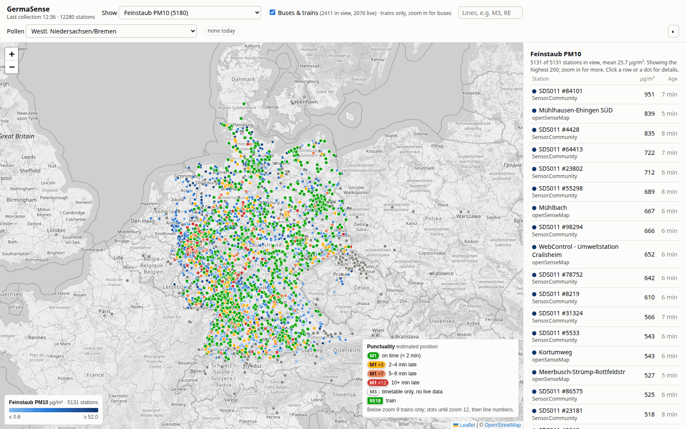
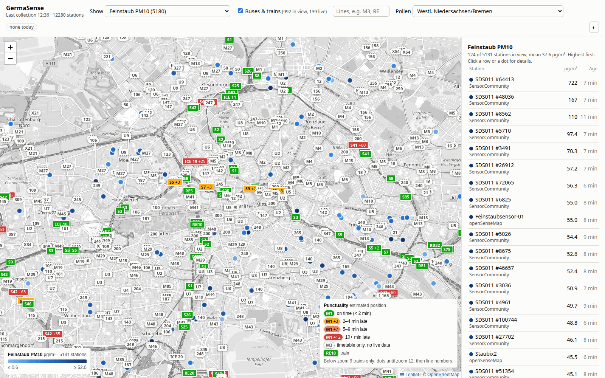
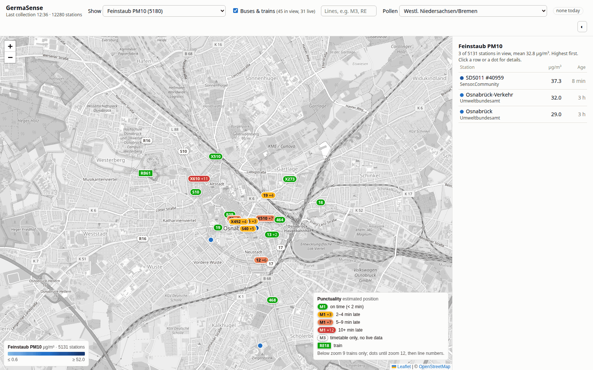
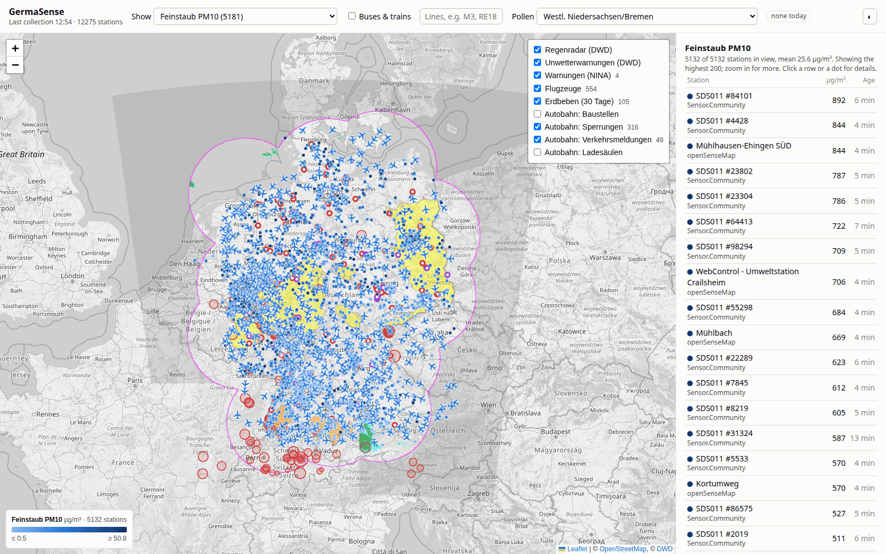

# GermaSense

A live map of about 12,000 public environmental sensors and every bus, tram and train in Germany,
with aircraft, Autobahn roadworks and closures, official warnings, rain radar and earthquakes as extra layers.
It runs on your own computer or a small home server. It needs only Python: no extra packages, no API keys.



| Berlin: buses, trams, S- and U-Bahn | Osnabrück: city buses with delays |
|---|---|
|  |  |



## Installation

You need **Python 3.9 or newer**, with SQLite 3.24 or newer, which every Python from the last years has.

**1. Install Python** if `python3 --version` (Windows: `py --version`) doesn't show 3.9 or newer.

- **Windows:**
  - Install from <https://www.python.org/downloads/>, or run `winget install Python.Python.3.12`.
  - Then use `py` wherever this README says `python3`.
- **macOS:**
  - Install from <https://www.python.org/downloads/>, or run `brew install python`.
- **Linux:**
  - Python is usually already installed.
  - Otherwise, on Debian or Ubuntu: `sudo apt install python3`.

**2. Get the code**, either by cloning it:

```
git clone https://github.com/ishallnotforget/germasense.git
cd germasense
```

or by downloading it: use **Code → Download ZIP** on GitHub, unpack it and open a terminal in the folder.

**3. Run it**

```
python3 serve.py
```

Then open <http://localhost:8642> in your browser. Stop it with Ctrl+C.

Options:
- `--port 9000`: use another port.
- `--host 0.0.0.0`: let other devices on your network open the map. The default only allows this computer.
- `--no-collect`: serve existing data only, without collecting new data in the background.

To update to a newer version later, run `git pull` in the folder.

**First start:**
- **Sensors:** the first collection starts right away and takes 1–3 minutes, mostly waiting for openSenseMap. Reload the page after that. The server then collects again every 10 minutes for as long as it runs.
- **Buses & trains:** the first time someone ticks "Buses & trains", the server downloads the national timetable (about 270 MB) and builds its local cache. Once a day it checks whether gtfs.de has published a newer timetable and rebuilds only then, or after a week at the latest. Until the first build is done, the vehicle layer stays empty.

## Running it on a home server (e.g. HP MicroServer Gen8)

The program is built for small machines. Measured on a desktop PC:

| | |
|---|---|
| Collection run, all of Germany | 1–3 minutes, mostly waiting for openSenseMap; about 3 s of CPU |
| Sensor map response | about 30 ms, then under 1 ms from cache until the next collection; about 90 KB gzipped |
| Sensor database | grows to about 750 MB, then stays there: raw readings are kept 2 days, hourly averages 14 days |
| Timetable cache | 720 MB on disk; the build takes about 3 minutes (2 minutes of CPU) with 320 MB peak memory |
| Vehicles in view | 30–230 ms (a city up to the whole Ruhr); all trains in Germany 0.2 s per map area, cached 10 s |
| Extra layers | fetched only while someone has them open; the Autobahn layer takes about 5 s of ~450 small requests every 10 minutes |

A Gen8 Celeron or Xeon is about 2–3 times slower than that per core. That's fine for this load; budget 1 GB of RAM.

To run it as a service that starts with the machine, create `/etc/systemd/system/germasense.service`, with your user and folder:

```
[Unit]
Description=GermaSense live sensor map
After=network-online.target
Wants=network-online.target

[Service]
User=youruser
WorkingDirectory=/home/youruser/germasense
ExecStart=/usr/bin/python3 serve.py --host 0.0.0.0
Restart=on-failure

[Install]
WantedBy=multi-user.target
```

Then enable and start it:

```
sudo systemctl enable --now germasense
```

Open `http://<server-ip>:8642` from any device on your network. There is no login, so don't expose the port to the internet.

## What's on the map

- **Sensor dropdown:** pick a quantity, such as PM10, temperature, rain, solar radiation, water level, radiation, NO₂ or parking spaces.
  - Colours span the 5th–95th percentile, so a single broken sensor doesn't wash out the map.
  - The side panel lists the stations in view, highest first. Click one to see a chart for 24 h, 48 h or 7 days.
- **Buses & trains:** colour shows punctuality. Dashed outlines mean timetable only, with no live data.
  - Zoom levels: below zoom 9 only trains are shown, coloured dots until zoom 12, line numbers above that.
  - Type line names into the filter field, e.g. `M3`, `RE18` or `107 U11`.
- **Pollen:** pick one of the 27 DWD forecast regions in the header.
- **Layers** (button at the top right of the map). Each layer is only fetched while it is switched on.
  - **Regenradar** and **Unwetterwarnungen:** images straight from DWD. With the warnings on, click anywhere on the map to read the warning for that place.
  - **Warnungen (NINA):** civil-protection warnings (MoWaS, KATWARN, BIWAPP, flood centres, police), with the affected area.
  - **Flugzeuge:** aircraft over Germany, updated every 10 s and moved smoothly in between. Grey ones are on the ground.
  - **Erdbeben:** earthquakes of the last 30 days. Filled circles are from the last 24 hours.
  - **Autobahn:** current roadworks, closures, accidents and traffic warnings, and fast chargers, drawn as rings.

## Data sources

| Source | What | Stations |
|---|---|---|
| [Sensor.Community](https://sensor.community) | Particulate matter, temperature, humidity, pressure, noise | ~6,600 |
| [openSenseMap](https://opensensemap.org) | senseBoxes: weather, particulates, light, UV, soil | ~1,500 |
| [DWD](https://opendata.dwd.de) weather stations | Temperature, humidity, wind, gusts, rain, sunshine, solar radiation, snow, visibility, every 10 min | ~1,100 |
| [BfS](https://odlinfo.bfs.de) | Gamma dose rate (radioactivity) and UV index | ~1,700 |
| [WSV Pegelonline](https://pegelonline.wsv.de) | Water level, water temperature, discharge on federal waterways | ~730 |
| [Umweltbundesamt](https://www.umweltbundesamt.de/daten/luft) | Official air quality: PM10, PM2.5, NO₂, O₃, SO₂, CO | ~400 |
| [ParkenDD](https://parkendd.de) | Free spaces in car parks of about ten cities | ~150 |
| DWD pollen forecast | Today's pollen load per region | 27 regions |
| [gtfs.de](https://gtfs.de) | National timetable and realtime delays | all of Germany |
| [adsb.lol](https://adsb.lol) (ODbL) | Aircraft positions | ~500 aircraft |
| [Autobahn GmbH](https://autobahn.api.bund.dev) | Roadworks, closures, traffic warnings, charging stations | ~3,000 items |
| [NINA / BBK](https://warnung.bund.dev) | Civil-protection warnings | as issued |
| [DWD GeoServer](https://maps.dwd.de) | Rain radar and weather warnings (map images) | all of Germany |
| [EMSC](https://www.seismicportal.eu) | Earthquakes | ~100 per month |

Map tiles are © OpenStreetMap contributors.

Please keep the 10-minute collection interval; these are free public services.

## Files

| File | Purpose |
|---|---|
| `serve.py` | Web server and JSON API; runs the collector in the background |
| `collector.py` | Fetches all sensor sources into `germasense.db`. Run it on its own: `python3 collector.py`, or `python3 collector.py summary` |
| `buses.py` | Timetable cache and vehicle positions. Rebuild the cache with `python3 buses.py refresh` |
| `layers.py` | Aircraft, Autobahn, NINA warnings and earthquakes, fetched on demand. Test them with `python3 layers.py` |
| `static/index.html` | The map |

Vehicle positions are estimated from the timetable and realtime delays, not GPS.
